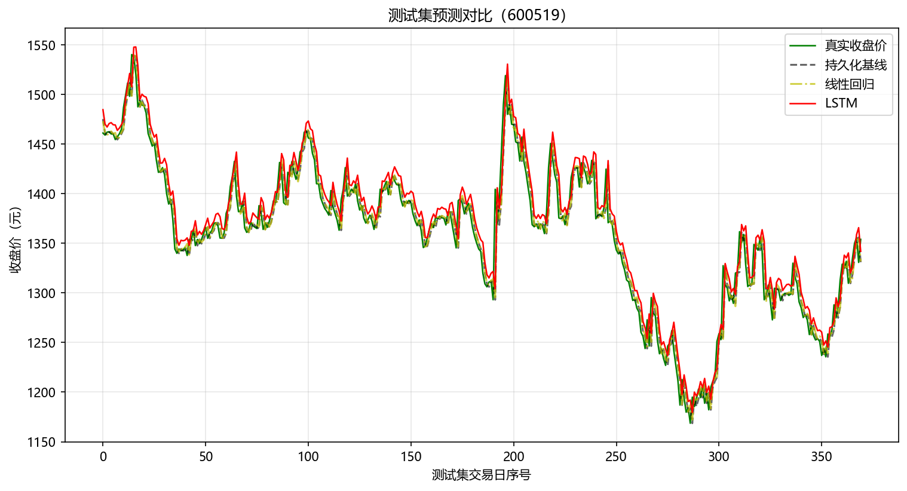
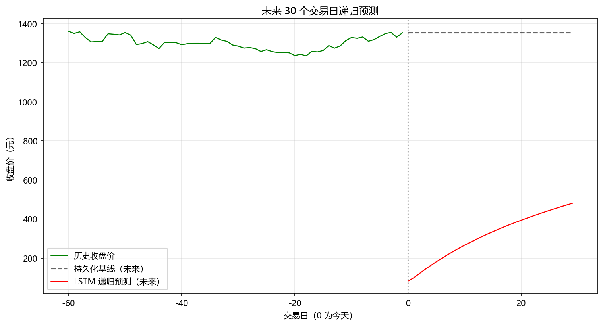

# A 股股票价格预测（LSTM vs 基线模型）

基于 LSTM 的时间序列预测项目：预测**贵州茅台（600519）**收盘价，并与持久化基线、线性回归对比，含未来 30 个交易日的递归多步预测。

> 本项目由 [Stock-Price-Prediction-LSTM](https://github.com/NourozR/Stock-Price-Prediction-LSTM) 改造而来：数据源换成 A 股真实行情、升级 Python 3 / Keras 3、新增基线模型对比与多步预测、补全评估指标（原版代码保留在 `legacy/`）。

## 数据

- 贵州茅台前复权日线（2019-01 至今，约 1900 个交易日）
- 来源：新浪财经行情接口，经 [akshare](https://github.com/akfamily/akshare) 获取
- `python fetch_data.py` 一键更新（可改 `SYMBOL` 换成其他 A 股）

## 快速开始

```bash
pip install -r requirements.txt   # akshare tensorflow-cpu scikit-learn pandas matplotlib
python fetch_data.py              # 拉取数据（默认茅台 600519）-> data/600519_daily.csv
python predict.py                 # 训练 + 评估 + 出图 -> output/
```

**换一只股票**（任意 A 股代码，沪/深/北交所自动识别）：

```bash
python fetch_data.py --code 000001          # 平安银行
python predict.py --data data/000001_daily.csv
```

Windows 也可以直接**双击 `run.bat`**：会提示输入股票代码（回车默认茅台 600519），自动完成拉数据、训练和出图。也可以在命令行传参：`run.bat 000001`。

## 方法

- **特征**：过去 10 个交易日收盘价（lookback=10），预测下一天
- **切分**：按时间顺序 80/20，不随机打乱（时间序列验证的基本要求）
- **模型**（同窗口、同切分，公平对比）：
  1. 持久化基线：直接拿前一天收盘价当预测——股价近似随机游走，这个基线其实很强
  2. 线性回归：lookback 窗口线性拟合
  3. LSTM：两层 LSTM（32→16）+ 全连接，Adam 训练
- **评估**：RMSE / MAE / MAPE
- **多步预测**：用测试集末尾窗口递归外推未来 30 个交易日

## 结果

运行 `python predict.py` 后，测试集表现如下（贵州茅台 600519，测试集为最近 20% 交易日）：

| 模型 | RMSE | MAE | MAPE |
|------|------|-----|------|
| 持久化基线 | 17.12 | 12.02 | 0.89% |
| 线性回归 | 17.06 | 12.12 | 0.89% |
| LSTM（200 epochs） | 19.43 | 15.37 | 1.13% |

**结论**：LSTM 与基线模型性能接近但未能稳定超越——这与股价近似随机游走（random walk）的理论预期一致。预测误差均值约 12-15 元（股价约 1350 元，MAPE ≈ 1%），说明日频股价的短期可预测性非常有限；同时验证了"复杂模型 ≠ 更好效果"，基线对比是时间序列建模的基本功。

输出图片：





## 局限与思考

1. 股价近似随机游走，短期可预测信息量有限——LSTM 若打不过持久化基线，说明"看起来复杂"的模型未必有效，这正是基线对比的意义
2. 递归多步预测会累积误差，实际应用需要滚动重训或概率预测（分位数回归）
3. 改进方向：加入成交量/技术指标、新闻与情绪特征、改用 Transformer 或概率模型

## 目录结构

```
fetch_data.py    拉取行情数据
predict.py       模型训练、评估、出图
legacy/          原版代码与数据（Python 2 版 LSTM）
output/          评估图片输出
data/            行情 CSV（运行 fetch_data.py 生成）
```
